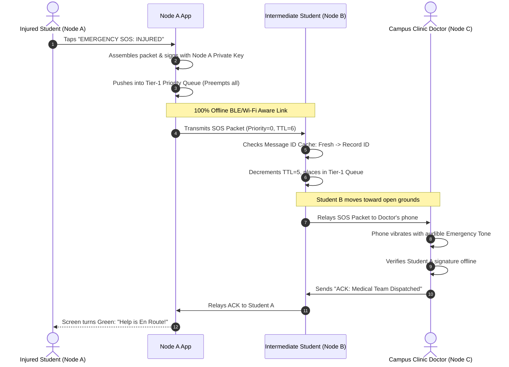
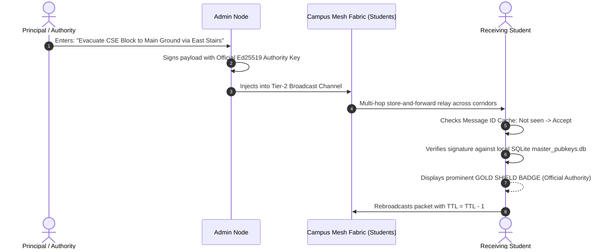

# STAGE 1: REQUIREMENT ENGINEERING & FEASIBILITY ANALYSIS
**Comprehensive Software Requirements Specification (SRS) — Team 12 (ANITS)**

---

## Document Overview
This document contains the complete, formal engineering requirements for the **Decentralized Offline-First Campus Mesh Network**. It details the physical operating environment, stakeholder personas, functional requirements, non-functional quality thresholds, and crisis use-case workflows.

```
┌────────────────────────────────────────────────────────────────────────┐
│  STAGE 1 SUB-STEPS:                                                    │
│  ├── 1.1: Operational Environment & Hardware Boundaries (Completed)   │
│  ├── 1.2: Stakeholder Personas & Role Hierarchy Matrix (Completed)     │
│  ├── 1.3: Formal Functional Requirements Catalog (FR-01 to FR-15)      │
│  ├── 1.4: Non-Functional Requirements & Performance Benchmarks (NFR)   │
│  └── 1.5: System Use Cases & Crisis Workflow Sequence Diagrams         │
└────────────────────────────────────────────────────────────────────────┘
```

---

## 1.1 Operational Environment & Hardware Boundaries

### 1. Physical Campus Footprint (ANITS Context)
* **Location & Footprint:** ~12 acres (~48,500 m²) along NH-16, Sangivalasa, Visakhapatnam.
* **Geographical Vulnerability:** Coastal Andhra Pradesh tropical belt, prone to severe cyclonic disturbances (e.g., Hudhud, Gulab). These events cause immediate regional electrical grid cuts, physical fiber backhaul breaks, and complete commercial cell tower (4G/5G) downtime.
* **Campus Facilities Covered:**
  * Multiple Academic Blocks (CSE, CSD, CSM, CIC, IT, ECE, EEE, Mechanical, Civil, Chemical).
  * Central Library, Administrative Building, and Seminar Auditoriums.
  * Boys' and Girls' On-Campus Student Hostels (~800 residential students).
  * Health Center / Clinic, Central Canteen, and Central Sports Grounds.

### 2. Structural Topology & Geometry
* **Vertical Architecture:** 5 to 6 floors per departmental block.
* **Floor Height:** 10 to 15 feet (~3.0 to 4.5 meters) per floor.
* **Building Construction Material:** Solid brick masonry partition walls with reinforced cement concrete (RCC) floor slabs and supporting pillars.
* **Inter-Block Separation:** 
  * Adjacent neighboring blocks: **20 to 40 meters** across open courtyards.
  * Extremities (e.g., Chemical/Civil blocks to Hostels/Sports Grounds): **150 to 300 meters**.

### 3. Quantitative Node Density & Sizing
* **Engineering Branches:** 8–10 Departments.
* **Undergraduate Cohort:** 4 Academic Years per branch, 3 to 5 sections per year, ~65 students per section.
  $$\text{Students per Branch} \approx 4 \times 4 \times 65 \approx 1,040 \text{ students}$$
* **Total Student Population:** **~5,500 to 6,500 active mobile nodes**.
* **Faculty & Administrative Staff:**
  * ~30 to 45 Teaching Faculty per branch (including HODs and Class Teachers).
  * ~15 to 20 Lab Technicians & Non-Teaching Staff per block.
  * Central Admin (Principal, Vice-Principal, Deans, Security, Clinic): ~60 personnel.
  * **Total Faculty/Admin Authority Nodes:** **~450 to 550 verified nodes**.
* **Combined Peak Network Scale:** **~6,000 to 7,000 active mobile transceivers**.

### 4. RF Path Loss & Indoor/Outdoor Propagation Insights
* **Vertical Floor Attenuation:** Solid RCC slabs attenuate 2.4 GHz and 5 GHz signals by **15 to 25 dB per floor**. Vertical multi-floor propagation cannot penetrate directly through 3+ floors and must rely on **open stairwell reflections** and **exterior corridor window spillover**.
* **Inter-Block Line-of-Sight (LoS):** Because adjacent blocks are only 20 to 40 meters apart, window-to-window radio paths across courtyards (LoS) have significantly lower attenuation (~1–3 dB) than indoor paths through brick walls.
* **Opportunistic Human Mobility ("Data Mules"):** Walking students naturally carry cached packet bundles across structural dead zones, bridging disconnected campus zones via Store-Carry-Forward delay-tolerant routing.

### 5. Hardware Baseline & Operating System Constraints
* **Primary Platform:** Android 10+ (API Level 29 minimum, API 33/34 recommended).
* **Required Radio Transceivers:**
  * Bluetooth 5.0+ supporting BLE Peripheral Mode (concurrent Advertising and Scanning).
  * Wi-Fi 802.11ac / 802.11ax chipset supporting native **Wi-Fi Aware (NAN / 802.11aq)**.
* **Zero External Dependencies:** No active SIM card, no cellular data, and no centralized Wi-Fi router connectivity required during offline operation.

---

## 1.2 Stakeholder Personas & Role Hierarchy Matrix

To eliminate the spread of unverified rumors and mass panic during crises, the system replaces open, unauthenticated civilian mesh models with a strict **4-Tier Cryptographic Role Hierarchy**:

```
┌────────────────────────────────────────────────────────────────────────┐
│ TIER 0: CAMPUS SYSTEM ADMINISTRATOR (Root CA & Directory Manager)      │
├────────────────────────────────────────────────────────────────────────┤
│ TIER 1: INSTITUTIONAL AUTHORITY (Principal, Deans, HODs, Wardens)      │
├────────────────────────────────────────────────────────────────────────┤
│ TIER 2: EMERGENCY & MEDICAL RESPONDERS (Clinic Doctors, NSS Leads)     │
├────────────────────────────────────────────────────────────────────────┤
│ TIER 3: CAMPUS OCCUPANTS (Students, Staff, Classmates)                 │
└────────────────────────────────────────────────────────────────────────┘
```

### Detailed Persona Specifications

| Role Level | Persona | Key Responsibilities & Capabilities | Cryptographic Identity & UI Indicator |
| :---: | :--- | :--- | :--- |
| **Tier 0** | **Campus System Administrator** | • Manages root configuration on the Firebase backend.<br>• Signs and publishes the Master Public Key Directory (`master_pubkeys.db`).<br>• Revokes compromised keys. | **Root Authority Keypair**<br>(Backend Only) |
| **Tier 1** | **Institutional Authority**<br>*(Principal, Vice-Principal, Deans, HODs, Chief Wardens)* | • Issues campus-wide mandatory evacuation directives.<br>• Broadcasts zone-specific hazard warnings.<br>• Overrides routine chat traffic across the mesh. | **Official Authority Key (Ed25519)**<br>🛡️ **Verified Gold Shield Badge** on all receiving devices. |
| **Tier 2** | **Emergency & Medical Responders**<br>*(Campus Clinic Doctors, Security Chief, NCC/NSS Volunteers)* | • Receives high-priority Tier-1 SOS distress beacons.<br>• Dispatches first-aid teams and updates triage status.<br>• Conducts headcounts at safe muster points. | **Responder Keypair**<br>🟢 **Green Cross / Responder Badge** with direct acknowledgment capabilities. |
| **Tier 3** | **Campus Occupants**<br>*(Students, Lab Assistants, General Staff)* | • Triggers one-tap emergency SOS beacons.<br>• Receives and verifies official administrative broadcasts.<br>• Relays packets autonomously as intermediate mesh nodes.<br>• Sends zero-knowledge encrypted 1-to-1 private messages. | **Student Keypair (Ed25519)**<br>Standard User UI with Red SOS Trigger. |

---

## 1.3 Formal Functional Requirements Catalog

### Category A: Neighbor Discovery & Radio Management
* **FR-01 (Continuous BLE Discovery):** The system shall autonomously advertise and scan for nearby peer nodes using low-power BLE without requiring manual Bluetooth pairing.
* **FR-02 (Adaptive Duty-Cycling):** The BLE discovery service shall cycle between scanning (2s) and sleeping (6s) during standby to preserve battery life.
* **FR-03 (Wi-Fi Aware Dynamic Escalation):** When a high-priority SOS beacon or multi-packet bundle is queued, the system shall automatically initiate and negotiate an ad-hoc Wi-Fi Aware (NAN) data channel for high-throughput transfer.
* **FR-04 (Local Peer Registry):** The system shall maintain an active in-memory and SQLite registry of detected peers, recording `Node_ID`, `Role`, `RSSI`, and `Last_Seen_Timestamp`.

### Category B: Routing, Relaying & Storm Suppression
* **FR-05 (Multi-Hop Hop-to-Hop Relaying):** Every participating device shall act as an autonomous router, forwarding packets to reachable neighbors up to a maximum Time-To-Live ($\text{TTL} = 5$ to $7$).
* **FR-06 (Rolling Message ID Deduplication Cache):** Each node shall maintain a rolling cache (ring buffer of last 1,000 Message IDs); any received packet whose ID already exists in the cache shall be **instantly dropped** to prevent infinite loops and broadcast storms.
* **FR-07 (Store-Carry-Forward DTN Persistence):** If a packet cannot be immediately forwarded due to physical radio partition, the system shall cache the bundle in local SQLite storage until an encounter with a new peer occurs.

### Category C: Role-Based QoS & Emergency Handling
* **FR-08 (Strict 3-Tier Priority Queuing):** The radio driver shall process outgoing packets strictly by priority:
  * *Queue 1 (High):* Emergency SOS / Medical beacons (preempts all traffic).
  * *Queue 2 (Medium):* Verified Faculty Announcements.
  * *Queue 3 (Low):* Routine peer-to-peer chat (throttled when channel capacity is constrained).
* **FR-09 (One-Tap Emergency SOS Trigger):** The system shall provide an unblockable, prominent emergency trigger enabling a student to broadcast an urgent distress alert with roll number, medical issue, and battery status in $\le 2$ taps.
* **FR-10 (Emergency Acknowledgment Return Path):** When an SOS is accepted by a Medical Responder, the system shall route an authenticated `ACK` packet back to the victim's device to confirm that rescue is en route.

### Category D: Cryptographic Trust & Privacy
* **FR-11 (Cloud Directory Background Sync):** When connected to campus Wi-Fi or internet, the app shall silently synchronize the master directory of user roles and public keys from Firebase to local SQLite.
* **FR-12 (Offline Signature Verification):** The system shall cryptographically verify the digital signature of any faculty broadcast against the local public key cache **100% offline**.
* **FR-13 (Impersonation Rejection):** Any broadcast claiming Faculty or Admin status that lacks a valid cryptographic signature shall be flagged with a prominent red warning as an unverified rumor.
* **FR-14 (Zero-Knowledge 1-to-1 Private Chat):** 1-to-1 messages shall be end-to-end encrypted with the recipient's public key so intermediate relay nodes cannot read message contents.

---

## 1.4 Non-Functional Requirements & Performance Benchmarks (NFR)

| Metric ID | Parameter | Benchmark Threshold | Justification |
| :---: | :--- | :--- | :--- |
| **NFR-01** | **Standby Battery Drain** | $\le 3.5\%$ per hour | Ensures mobile phones survive 24 to 48 hours of campus blackout without recharging. |
| **NFR-02** | **Single-Hop Latency** | $< 1.5$ seconds | Ensures swift packet transfer between passing students in corridors. |
| **NFR-03** | **Multi-Hop SOS Delivery Delay** | $< 8.0$ seconds (within 4 hops) | Critical medical alerts must reach campus responders within seconds. |
| **NFR-04** | **Packet Delivery Ratio (PDR)** | $\ge 90\%$ for SOS beacons<br>$\ge 75\%$ for general chat | Near-lossless reliability required for mission-critical life-safety traffic. |
| **NFR-05** | **Broadcast Storm Reduction** | $> 65\%$ suppression vs. naive flooding | Prevents channel saturation and packet collapse in dense auditoriums or hostel blocks. |
| **NFR-06** | **Cryptographic Execution Time** | $< 5$ ms per verification | Prevents UI freezing and mobile CPU throttling during high packet reception bursts. |
| **NFR-07** | **Offline Storage Footprint** | $< 50$ MB total disk usage | Must operate smoothly on budget student smartphones with limited internal storage. |

---

## 1.5 System Use Cases & Crisis Workflow Scenarios

### Use Case 1: Trapped Student Triggers Medical SOS Alert


### Use Case 2: Principal Broadcasts Evacuation Directive


### Use Case 3: Zero-Knowledge 1-to-1 Encrypted Peer Chat
`mermaid
sequenceDiagram
    autonumber
    actor Alice as Sender (Student A)
    participant PhoneA as Node A App
    participant Relay as Intermediate Relays (Nodes B & C)
    participant PhoneD as Node D App
    actor Dave as Recipient (Student D)

    Alice->>PhoneA: Types private message to Dave (Reg No: A23126551098)
    PhoneA->>PhoneA: Looks up Dave's Public Key in local SQLite key store
    PhoneA->>PhoneA: Encrypts payload via ECIES / AES-256-GCM + Dave PubKey
    PhoneA->>PhoneA: Signs encrypted ciphertext with Alice Private Key
    PhoneA->>Relay: Injects into Tier-3 Low Priority Queue (Type=0x03, TTL=6)
    Note over Relay: Intermediate nodes read ONLY header metadata (UUID, TTL)<br/>Payload is unreadable ciphertext (Zero-Knowledge)
    Relay->>Relay: Checks cache -> Decrements TTL=5 -> Re-broadcasts
    Relay->>PhoneD: Final hop delivers packet to Dave
    PhoneD->>PhoneD: Verifies Alice signature -> Decrypts with Dave Private Key
    PhoneD-->>Dave: Displays plaintext message in private conversation thread
`
