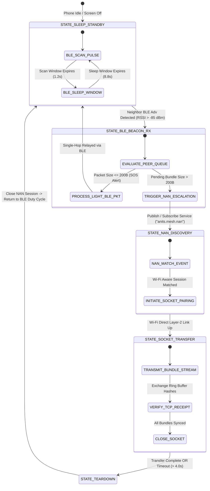

# STAGE 2: SYSTEM ARCHITECTURAL & PROTOCOL DESIGN
**Formal Technical Specifications & Wire Protocols — Team 12 (ANITS)**

---

## Document Overview
This document establishes the definitive engineering blueprints for the **Decentralized Offline-First Campus Mesh Network**. It specifies the exact packet wire frame byte structures, the dual-radio finite state machine (FSM), the storm-suppression routing engine, and the embedded SQLite database schemas.

```
┌────────────────────────────────────────────────────────────────────────┐
│  STAGE 2 BLUEPRINT SPECIFICATIONS:                                     │
│  ├── 2.1: Packet Wire Frame Specification (Binary Layout & Encodings)  │
│  ├── 2.2: Dual-Radio Finite State Machine (BLE ➔ Wi-Fi Aware NAN)      │
│  ├── 2.3: Routing Daemon & Storm Suppression Specification             │
│  └── 2.4: Database, Cryptographic Keys & Cloud Sync Schema Design      │
└────────────────────────────────────────────────────────────────────────┘
```

---

## 2.1 Packet Wire Frame Specification

In an ad-hoc radio environment (BLE 5.0 and Wi-Fi Aware), serialization overhead directly impairs battery consumption, channel airtime, and packet collision rates. Traditional text-based serializations (such as JSON or XML) induce $> 300\%$ memory overhead. Therefore, our protocol mandates a **strictly packed binary wire format** utilizing Big-Endian (Network Byte Order) encoding.

### 1. Packet Wire Architecture Overview

Every mesh packet consists of three contiguous segments:
1. **Fixed Header (70 Bytes):** Always present, containing critical routing, priority, TTL, and addressing metadata.
2. **Variable Payload ($0$ to $N$ Bytes):** The message content, triage alert, or encrypted ciphertext.
3. **Trailing Verification Block (68 Bytes):** Cryptographic Ed25519 signature ($64$ bytes) + CRC-32 Frame Check Sequence ($4$ bytes).

```
 0                   1                   2                   3
 0 1 2 3 4 5 6 7 8 9 0 1 2 3 4 5 6 7 8 9 0 1 2 3 4 5 6 7 8 9 0 1
+-+-+-+-+-+-+-+-+-+-+-+-+-+-+-+-+-+-+-+-+-+-+-+-+-+-+-+-+-+-+-+-+
|          Magic Bytes          | Protocol Ver  |  Pkt Type/QoS |
+-+-+-+-+-+-+-+-+-+-+-+-+-+-+-+-+-+-+-+-+-+-+-+-+-+-+-+-+-+-+-+-+
|     Flags     |  Initial TTL  | Remaining TTL |   Reserved    |
+-+-+-+-+-+-+-+-+-+-+-+-+-+-+-+-+-+-+-+-+-+-+-+-+-+-+-+-+-+-+-+-+
|                                                               |
+                       Message UUID (16 Bytes)                 +
|                                                               |
+                                                               +
|                                                               |
+-+-+-+-+-+-+-+-+-+-+-+-+-+-+-+-+-+-+-+-+-+-+-+-+-+-+-+-+-+-+-+-+
|                                                               |
+                   Source Node ID / Hash (16 Bytes)            +
|                                                               |
+                                                               +
|                                                               |
+-+-+-+-+-+-+-+-+-+-+-+-+-+-+-+-+-+-+-+-+-+-+-+-+-+-+-+-+-+-+-+-+
|                                                               |
+                Destination Node ID / Hash (16 Bytes)          +
|                   (0xFF...FF for Broadcast)                   |
+                                                               +
|                                                               |
+-+-+-+-+-+-+-+-+-+-+-+-+-+-+-+-+-+-+-+-+-+-+-+-+-+-+-+-+-+-+-+-+
|                     Sequence Number (32-Bit)                  |
+-+-+-+-+-+-+-+-+-+-+-+-+-+-+-+-+-+-+-+-+-+-+-+-+-+-+-+-+-+-+-+-+
|                                                               |
+                   Unix Epoch Timestamp (64-Bit)               +
|                                                               |
+-+-+-+-+-+-+-+-+-+-+-+-+-+-+-+-+-+-+-+-+-+-+-+-+-+-+-+-+-+-+-+-+
|      Payload Length (uint16)  |                               |
+-+-+-+-+-+-+-+-+-+-+-+-+-+-+-+-+                               +
|                                                               |
+                   Variable Payload (0 to N Bytes)             +
|                                                               |
+-+-+-+-+-+-+-+-+-+-+-+-+-+-+-+-+-+-+-+-+-+-+-+-+-+-+-+-+-+-+-+-+
|                                                               |
+                 Ed25519 Digital Signature (64 Bytes)          +
|                                                               |
+                                                               +
|                                                               |
+-+-+-+-+-+-+-+-+-+-+-+-+-+-+-+-+-+-+-+-+-+-+-+-+-+-+-+-+-+-+-+-+
|                   CRC-32 Checksum (32-Bit)                    |
+-+-+-+-+-+-+-+-+-+-+-+-+-+-+-+-+-+-+-+-+-+-+-+-+-+-+-+-+-+-+-+-+
```

---

### 2. Granular Field-by-Field Byte Specification

| Byte Offset | Field Name | Data Type | Size (Bytes) | Description & Value Rules |
| :---: | :--- | :---: | :---: | :--- |
| **0x00–0x01** | `magic_bytes` | uint16 | 2 | Protocol identifier. Fixed value: `0x4D53` (ASCII `'MS'` for Mesh System). Rejects alien noise packets immediately. |
| **0x02** | `protocol_version` | uint8 | 1 | Protocol iteration. Fixed value: `0x01` (Version 1.0). |
| **0x03** | `packet_type_qos` | uint8 | 1 | Encodes packet classification and QoS tier: <br>• `0x01`: Emergency SOS Beacon (Tier 1 Priority)<br>• `0x02`: Official Authority Broadcast (Tier 2 Priority)<br>• `0x03`: End-to-End Encrypted Private Chat (Tier 3 Priority)<br>• `0x04`: Neighbor Discovery / Keep-Alive Heartbeat<br>• `0x05`: Explicit Delivery Acknowledgment (ACK) |
| **0x04** | `flags` | uint8 | 1 | Bitfield flags governing cryptographic and compression handling:<br>• Bit 0 (`0x01`): `IS_ENCRYPTED` (Payload ciphertext)<br>• Bit 1 (`0x02`): `REQUIRES_ACK` (Must send return receipt)<br>• Bit 2 (`0x04`): `IS_AUTHORITY_SIGNED` (Gold Badge candidate)<br>• Bit 3 (`0x08`): `IS_COMPRESSED` (Deflate payload)<br>• Bits 4–7: Reserved for future extensions. |
| **0x05** | `initial_ttl` | uint8 | 1 | Originating Time-To-Live value (Default: `0x06`). Used to calculate hop count: Hops = initial_ttl - remaining_ttl. |
| **0x06** | `remaining_ttl` | uint8 | 1 | Decremented by 1 at each forwarding node. When `remaining_ttl == 0`, packet is **dropped** to prevent infinite loops. |
| **0x07** | `reserved` | uint8 | 1 | Padding byte for 32-bit word alignment. Set to `0x00`. |
| **0x08–0x17** | `message_uuid` | byte[16] | 16 | Globally unique 128-bit RFC-4122 UUID generated by the source node. Used for instant ring-buffer deduplication. |
| **0x18–0x27** | `source_node_id` | byte[16] | 16 | SHA-256 truncated hash of originating user's verified campus ID (Roll No / Staff ID) or Public Key fingerprint. |
| **0x28–0x37** | `dest_node_id` | byte[16] | 16 | Target node hash. For public campus announcements or SOS alerts, set to `0xFFFFFFFFFFFFFFFFFFFFFFFFFFFFFFFF` (Broadcast). |
| **0x38–0x3B** | `sequence_number` | uint32 | 4 | Monotonically increasing sequence counter generated by source node. Defends against replay attacks. |
| **0x3C–0x43** | `timestamp` | uint64 | 8 | Milliseconds since Unix epoch (UTC) when packet was generated. Validates packet freshness (T_now - T_pkt < 3600s). |
| **0x44–0x45** | `payload_length` | uint16 | 2 | Length of contiguous payload data in bytes (L in [0, 65535]). For BLE GATT chunking: L <= 400 Bytes. |
| **0x46 ...** | `payload_data` | byte[L] | L | Variable payload content (Text, Structured JSON, SOS Coordinates, Medical Status). |
| **Tail - 68** | `signature` | byte[64] | 64 | Asymmetric Ed25519 digital signature generated over [0x00 ... (0x46 + L - 1)]. Guarantees zero tampering. |
| **Tail - 4** | `crc32` | uint32 | 4 | IEEE 802.3 32-bit cyclic redundancy check over entire packet preceding this field. Guards against radio bit flips. |

---

### 3. Payload Sub-Schemas by Packet Type

#### Type `0x01`: Emergency SOS Payload (Structured Binary Format)
When life safety is on the line, payload parsing must not fail. The SOS payload is encoded as a compact 32-byte struct:
```
+-+-+-+-+-+-+-+-+-+-+-+-+-+-+-+-+-+-+-+-+-+-+-+-+-+-+-+-+-+-+-+-+
| Emergency Type| Medical Code  | Battery Status| Trapped Status|
+-+-+-+-+-+-+-+-+-+-+-+-+-+-+-+-+-+-+-+-+-+-+-+-+-+-+-+-+-+-+-+-+
|                     Last Known Floor Number                   |
+-+-+-+-+-+-+-+-+-+-+-+-+-+-+-+-+-+-+-+-+-+-+-+-+-+-+-+-+-+-+-+-+
|                    Campus Block Code (uint32)                 |
+-+-+-+-+-+-+-+-+-+-+-+-+-+-+-+-+-+-+-+-+-+-+-+-+-+-+-+-+-+-+-+-+
|               Estimated Latitude (IEEE 754 Float)             |
+-+-+-+-+-+-+-+-+-+-+-+-+-+-+-+-+-+-+-+-+-+-+-+-+-+-+-+-+-+-+-+-+
|              Estimated Longitude (IEEE 754 Float)             |
+-+-+-+-+-+-+-+-+-+-+-+-+-+-+-+-+-+-+-+-+-+-+-+-+-+-+-+-+-+-+-+-+
|          Victim Roll Number (12 Bytes ASCII Padded)           |
|                 e.g., "A23126551113\0"                       |
+-+-+-+-+-+-+-+-+-+-+-+-+-+-+-+-+-+-+-+-+-+-+-+-+-+-+-+-+-+-+-+-+
```
* **Emergency Type (uint8):** `0x01` = Medical Trauma, `0x02` = Structural Collapse / Trapped, `0x03` = Cyclone Hazard, `0x04` = General Distress.
* **Battery Status (uint8):** Current device percentage ($0–100$) so responders prioritize victims with rapidly dying devices.
* **Campus Block Code (uint32):** `0x01` = CSE Block, `0x02` = Mechanical Block, `0x03` = Girls Hostel, `0x04` = Boys Hostel, `0x05` = Central Admin.

---

## 2.2 Dual-Radio Finite State Machine (FSM)

A core engineering innovation of this capstone is **Dual-Radio Energy Synergy**. Running Wi-Fi Aware (NAN) continuously drains student phone batteries in under 6 hours (~18%/hr). Conversely, relying solely on BLE limits data throughput to $< 25\text{ kbps}$ and restricts payload sizes.

Our architecture enforces a **two-tier escalation finite state machine**:
1. **Tier 1 (BLE 5.0 Low-Duty Cycle):** Sustains passive 24/7 background neighbor discovery and lightweight beaconing at $\le 3.2\%$/hour battery drain.
2. **Tier 2 (Wi-Fi Aware NAN Cluster Escalation):** Dynamically awakens high-speed Wi-Fi Aware direct TCP/UDP sockets only when pending multi-message bundles or high-bandwidth payloads are ready to transmit.



### State Definitions & Transition Criteria

1. **`STATE_SLEEP_STANDBY` (Duty-Cycled Radio Sleep):**
   * *BLE Scan Duty Cycle:* Active scan for $1.2$ seconds, passive sleep for $8.8$ seconds ($12\%$ operational duty cycle).
   * *BLE Advertising:* Non-connectable manufacturer-specific data beacon broadcast every $2.5$ seconds containing truncated Node ID and current queue depth.
2. **`STATE_BLE_BEACON_RX` (Neighbor Assessment):**
   * Triggered when a neighbor node's advertisement is intercepted with $\text{RSSI} \ge -85\text{ dBm}$.
   * If the packet is a high-priority SOS beacon ($L \le 200\text{ bytes}$), it is processed and relayed directly over BLE GATT without incurring Wi-Fi Aware power escalation.
3. **`STATE_NAN_DISCOVERY` (High-Throughput Escalation):**
   * Triggered when message payload $> 200\text{ bytes}$ or pending message queue depth $\ge 3$ bundles.
   * `WifiAwareManager` calls `attach()` and publishes the campus service descriptor `"edu.anits.mesh.service"`.
4. **`STATE_SOCKET_TRANSFER` (Direct Socket Streaming):**
   * An encrypted TCP socket is bound over the NAN network interface (`fe80::` Link-Local IPv6).
   * Data is streamed at sustained physical throughputs of $4.5\text{ Mbps}$ to $18\text{ Mbps}$, clearing multi-message bundles in under $450\text{ ms}$.
5. **`STATE_TEARDOWN` (Energy Conservation Fallback):**
   * To prevent battery hemorrhaging, the NAN network session enforces an aggressive hard timeout of $4.0\text{ seconds}$.
   * Immediately upon socket termination, Wi-Fi Aware is shut down, returning the device to ultra-low-power BLE standby.

---

## 2.3 Routing Daemon & Storm Suppression Specification

In dense campus environments (e.g., hundreds of students congregated in the CSE block or hostels), naive flooding causes catastrophic **broadcast storms**: radio collision rates exceed $70\%$, causing severe network packet collapse.

Our routing engine combines **Directed Controlled Flooding**, **Ring Buffer Deduplication**, and **Role-Based Priority Preemption**.

### 1. The 3-Tier Rolling Deduplication Filter

Every incoming packet traverses a 3-stage validation barrier before any relaying or processing occurs:

```
Incoming Packet
       │
       ▼
┌──────────────────────────────────────────────┐
│ Barrier 1: CRC-32 Frame Integrity Check      │ ──[Corrupted]──> DISCARD
└──────────────────────┬───────────────────────┘
                       │ [Valid Checksum]
                       ▼
┌──────────────────────────────────────────────┐
│ Barrier 2: Rolling Ring-Buffer Cache Lookup  │ ──[Seen UUID]──> INSTANT DROP
│ (Fast O(1) in-memory Hash Set of last 1,000) │
└──────────────────────┬───────────────────────┘
                       │ [Fresh UUID]
                       ▼
┌──────────────────────────────────────────────┐
│ Barrier 3: TTL Decrement & Boundary Check    │ ──[TTL <= 0]───> DROP & LOG
│ remaining_ttl = remaining_ttl - 1            │
└──────────────────────┬───────────────────────┘
                       │ [TTL > 0]
                       ▼
Accept into Local SQLite & Dispatch to Priority Queue
```

* **Ring-Buffer Specifications:**
  * Fixed capacity: $1,000$ most recent `message_uuid` hashes.
  * In-memory lookup complexity: $O(1)$ amortized using a synchronized HashSet backed by a circular array.
  * Cache eviction: FIFO circular overwrite once $1,000$ entries are exceeded.

---

### 2. Role-Based 3-Tier Strict Priority Queuing Algorithm

The transmitter routing daemon does not operate on simple First-In-First-Out (FIFO) queuing. All outbound traffic is partitioned into three discrete priority queues:

```
Outbound Packet Channel
           │
           ▼
┌────────────────────────────────────────────────────────┐
│ QUEUE 1: EMERGENCY SOS & RESCUE ALERTS (Tier 1)        │  PREEMPTS ALL
│ • Packet Type: 0x01                                    │  Latency Budget: < 1.5s
└──────────────────────────┬─────────────────────────────┘
                           │ [If Queue 1 Empty]
                           ▼
┌────────────────────────────────────────────────────────┐
│ QUEUE 2: VERIFIED AUTHORITY BULLETINS (Tier 2)         │  PREEMPTS CHAT
│ • Packet Type: 0x02 (Gold Shield Signed)               │  Latency Budget: < 10.0s
└──────────────────────────┬─────────────────────────────┘
                           │ [If Queue 1 & 2 Empty]
                           ▼
┌────────────────────────────────────────────────────────┐
│ QUEUE 3: ROUTINE PEER-TO-PEER PRIVATE CHAT (Tier 3)    │  THROTTLED
│ • Packet Type: 0x03                                    │  Best-effort DTN
└────────────────────────────────────────────────────────┘
```

#### Starvation Prevention (Priority Aging Rule):
To ensure Queue 3 (Student Peer Chat) is not starved indefinitely during prolonged faculty announcements, every message in Queue 3 increments an `aging_counter` every $15$ seconds. If $\text{aging\_counter} \ge 4$ ($60$ seconds unserved), the packet is temporarily elevated to Tier 2 priority for one transmission slot.

---

## 2.4 Database, Cryptographic Keys & Cloud Sync Schema

The local smartphone storage architecture must operate completely disconnected from external internet infrastructure while maintaining full relational integrity and cryptographic trust.

### 1. Embedded SQLite / Room Database Schema (Client Side)

The client database consists of four normalized tables managed via **Android Jetpack Room**:

```sql
-- 1. Discovered Mesh Neighbors Table
CREATE TABLE table_peers (
    node_id TEXT PRIMARY KEY NOT NULL,
    campus_roll_no TEXT,
    assigned_role INTEGER NOT NULL,          -- 0=Admin, 1=Authority, 2=Responder, 3=Student
    last_seen_timestamp INTEGER NOT NULL,
    last_rssi INTEGER NOT NULL,
    preferred_radio TEXT NOT NULL            -- 'BLE' or 'WIFI_AWARE'
);

-- 2. Master Message Store (Inbox / Outbox / Relayed Bundles)
CREATE TABLE table_messages (
    message_uuid TEXT PRIMARY KEY NOT NULL,
    packet_type INTEGER NOT NULL,            -- 0x01=SOS, 0x02=Notice, 0x03=Chat
    source_node_id TEXT NOT NULL,
    dest_node_id TEXT NOT NULL,
    sequence_number INTEGER NOT NULL,
    timestamp INTEGER NOT NULL,
    initial_ttl INTEGER NOT NULL,
    remaining_ttl INTEGER NOT NULL,
    payload BLOB NOT NULL,
    signature BLOB,
    is_verified INTEGER NOT NULL DEFAULT 0,  -- 0=Unverified, 1=Verified Gold Shield, -1=Fraudulent
    delivery_status TEXT NOT NULL            -- 'QUEUED', 'FORWARDED', 'DELIVERED', 'ACK_RECEIVED'
);

-- 3. Offline Cryptographic Keyring Table (Pre-synced from Cloud Directory)
CREATE TABLE table_public_keys (
    node_id TEXT PRIMARY KEY NOT NULL,
    campus_roll_no TEXT NOT NULL UNIQUE,
    full_name TEXT NOT NULL,
    role_level INTEGER NOT NULL,             -- 1=Principal/Dean, 2=HOD, 3=Faculty, 4=Clinic/Security
    department TEXT NOT NULL,                -- 'CSE', 'ECE', 'ADMIN', etc.
    ed25519_public_key BLOB NOT NULL,        -- 32-Byte Raw Public Key
    authority_cert_signature BLOB NOT NULL,  -- Root CA signature validating this user's credentials
    sync_epoch INTEGER NOT NULL
);

-- 4. Ring-Buffer Message Deduplication Cache Table
CREATE TABLE table_seen_cache (
    message_uuid TEXT PRIMARY KEY NOT NULL,
    received_timestamp INTEGER NOT NULL
);

CREATE INDEX idx_messages_queue ON table_messages(packet_type, delivery_status);
CREATE INDEX idx_seen_cache_time ON table_seen_cache(received_timestamp);
```

---

### 2. Centralized Cloud Firestore Directory Schema (Pre-Crisis Sync)

When devices are connected to ANITS campus Wi-Fi or cellular networks, a background worker (`WorkManager`) syncs the master institutional directory from Cloud Firestore:

```
campus_master_directory/ (Collection)
   ├── {user_uid}/ (Document)
   │     ├── roll_number: "A23126551113"
   │     ├── full_name: "P. Darakesu Hemanth"
   │     ├── role: "STUDENT_LEAD" (Tier 3)
   │     ├── department: "CSE (Data Science)"
   │     ├── ed25519_public_key: <32-byte Base64>
   │     ├── authority_signature: <64-byte Base64 Root CA Signature>
   │     ├── is_active: true
   │     └── last_directory_update: 1774900800
   │
   └── {authority_uid}/ (Document)
         ├── roll_number: "FAC_CSE_042"
         ├── full_name: "Dr. S. Adinarayana Salina"
         ├── role: "INSTITUTIONAL_AUTHORITY" (Tier 1 - Gold Shield)
         ├── department: "CSE"
         ├── ed25519_public_key: <32-byte Base64>
         ├── authority_signature: <64-byte Base64 Root CA Signature>
         └── is_active: true
```

---

### 3. Native Android Technology Stack & Gradle Configuration

To support Wi-Fi Aware (NAN) and BLE 5.0 alongside hardware-accelerated Ed25519 cryptography, the project mandates the following build configuration:

* **Language:** Kotlin 1.9+
* **Minimum Android SDK:** API Level 29 (Android 10.0 — mandatory for native `android.net.wifi.aware`)
* **Target / Compile Android SDK:** API Level 34 (Android 14.0)
* **Core Libraries & Frameworks:**
  * `androidx.room:room-runtime:2.6.1` & `androidx.room:room-ktx:2.6.1` (SQLite Object Relational Mapping)
  * `org.jetbrains.kotlinx:kotlinx-coroutines-android:1.7.3` (Asynchronous packet buffers & state flows)
  * `com.google.crypto.tink:tink-android:1.11.0` OR `org.bouncycastle:bcprov-jdk15on:1.70` (Ed25519 asymmetric cryptography)
  * `com.google.firebase:firebase-firestore-ktx:24.10.0` (Online directory pre-synchronization)
  * `androidx.work:work-runtime-ktx:2.9.0` (Silent periodic background directory sync)
